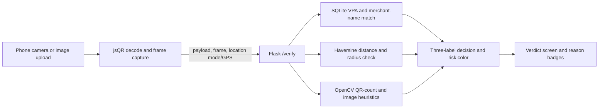

# ShieldPay Expo Guide

**Project:** ShieldPay: A Physical-to-Digital Trust Framework for QR Code Tampering Detection in Enhancing Digital Banking Security  
**Team:** Final-year project by you and Pooja  
**Guide:** Dr. M.S. Padmavathi, M.O.P. Vaishnav College for Women, Chennai

## Project Layout

The existing Flask page, CSV merchant list, and sample QR directories remain in place. New files add the SQLite registry (`schema.sql`, `merchant_store.py`, `seed_db.py`), combined API (`app.py`), OpenCV signals (`tamper_detection.py`), printable prop generator (`generate_expo_props.py`), measured evaluation (`evaluate_extended.py`), and this guide. Running the prop generator creates `demo_props/`; the app creates `instance/shieldpay.sqlite3` on first start.

```text
app.py                    Flask routes and /verify decision rules
merchant_store.py         SQLite access and additive CSV-to-SQLite seed import
schema.sql                merchants table and index
seed_db.py                repeatable first-run seed command
tamper_detection.py       OpenCV multi-QR and image heuristics
templates/index.html      Existing ShieldPay page plus camera/location results
static/jsQR.js            Local browser QR decoder
generate_expo_props.py    A-E printable QR generator
evaluate_extended.py      175-case end-to-end synthetic evaluation
demo_props/               Generated A-E PNG files
```

## Run It

Use Python 3.10 as specified for the project. In PowerShell from the project folder:

```powershell
py -3.10 -m venv venv
.\venv\Scripts\Activate.ps1
python -m pip install -r requirements.txt
python seed_db.py
python generate_expo_props.py
python app.py
```

Open `http://127.0.0.1:5000` on the same computer. The 26 sample merchants are loaded from `merchants.csv`, including M026, a fictional Choolai demo merchant with an approximate demo point and a 2 km radius. Existing samples use their configured coordinates and the default five-foot radius. New CSV rows are added to an existing database on app startup. These locations and addresses are test data, not verified shop details.

## Publish a Demo Link

The repository includes `render.yaml` for a Render web service. To publish it, create a GitHub repository containing the project (do not upload `venv/`, `.env`, or local files containing secrets), then in Render choose **New > Blueprint**, connect the repository, and deploy the `shieldpay-demo` service. Render will provide an HTTPS URL after the build succeeds. Camera and location access require HTTPS and the user's permission.

This is a public prototype, not a production payment or authentication service. The demo merchant database is initialized from `merchants.csv` and can be recreated at startup; local SQLite changes on a free ephemeral host are not durable. Scan history stays in each user's browser. Do not use real customer, payment, or confidential merchant data.

The SQLite schema includes `shop_address`, `merchant_registration_number`, `bank_verified_merchant_id`, and `registered_location_id`. Seeded values are clearly marked `DEMO-*`; bank-verified IDs remain empty and `registry_verification_status` is `sample_only`. No bank or government onboarding service is connected, so ShieldPay does not claim these merchants or addresses are verified. `/verify` returns only the assurance status/booleans and findings, not the full merchant row or precise registered coordinates. The database is server-side; in a deployed system, restrict write access to a separately authenticated onboarding process.

For a phone on the same Wi-Fi, the Flask process listens on the network interface. A phone browser requires a **trusted HTTPS certificate** for the computer's network name/IP before it will grant camera and GPS access. Set both certificate variables before starting Flask:

```powershell
$env:SHIELDPAY_TLS_CERT = "C:\path\to\trusted-cert.pem"
$env:SHIELDPAY_TLS_KEY = "C:\path\to\private-key.pem"
python app.py
```

Then open `https://<computer-name-or-ip>:5000` on the phone. A certificate with the correct subject alternative name must be trusted by the phone. `localhost` is also a secure browser context, but on a phone it points to the phone itself, not the laptop. Do not use the Flask development server as a production service.

For a local Choolai demonstration, upload `test_qrs/legit/legit_M026.png`. Its fictional merchant record uses an approximate point (13.0910, 80.2650) and a 2 km demo radius; only use it to demonstrate the flow, not as a real merchant or location. Other demo merchants retain the five-foot radius. Live GPS asks the browser for permission. Uploading an image and scanning with the camera both call `/verify`; the camera sends the `jsQR` payload and a captured frame. No payment is initiated.

## Props and 3-Minute Demo

`python generate_expo_props.py` creates PNGs with 300 DPI metadata: A-D target 9 cm (about 8.8 cm at print time), and E targets 4 cm. Print at **actual size / 100%**, disable fit-to-page, and use matte paper. Do not laminate; glare can affect camera capture. Keep the original QR visible around E so the two-code and local-texture signals can both be demonstrated.

Suggested spoken demo:

> “ShieldPay checks a UPI QR before payment. It compares the VPA and merchant name with a local trusted directory, checks whether the phone is near the registered shop, and looks for image-level signs of QR replacement. Image checks are explainable heuristics, not proof of fraud.”
>
> “First, this is prop A at the shop. The registered VPA and name match, the demo location is in range, and the image check found no strong warning, so the result is Trusted.”
>
> “I’ll keep the QR unchanged and move the demo location Away. The identity still matches, but the phone is about 15 kilometres from the registered point, so ShieldPay flags the scan as Suspicious.”
>
> “Prop B changes the displayed name, and prop C keeps the original name but swaps in another registered VPA. Both are Suspicious because the registry record does not agree with the QR.”
>
> “Now I place the smaller prop E partly over A. The original remains partly visible. ShieldPay checks for a second QR and for a localized image-texture change; these are heuristic signals, so I review the reason badges rather than treating the score as certainty.”
>
> “Finally, prop D uses an unregistered VPA. The directory cannot verify it, so the result is Unverifiable. ShieldPay never sends a payment; users should confirm payment details independently.”

Keep the QR flat, fill the camera view, and allow camera permission before starting. If the sticker scan does not trigger the expected badge under expo lighting, use the uploaded composite evaluation path and explain that image heuristics can miss real-world overlays.

## Architecture



## Evaluation

Run `python evaluate_extended.py`. It creates seven cases per merchant in memory and posts them through Flask's test client to the same `/verify` route used by the page. The groups are clean, wrong name, VPA swap, fake VPA, location away, sticker overlay, and combined attack. Location-away test points are generated beyond each merchant's configured radius. It prints accuracy, per-class precision/recall/F1, macro averages, a confusion matrix, and per-group results.

Latest run in this workspace:

| Measure | Result |
| --- | ---: |
| Cases correct | 182 / 182 |
| Accuracy | 1.0000 |
| Macro precision | 1.0000 |
| Macro recall | 1.0000 |
| Macro F1 | 1.0000 |
| Trusted / Suspicious / Unverifiable | 26 / 130 / 26 correct |

Confusion matrix (actual rows, predicted columns; label order Trusted, Suspicious, Unverifiable):

```text
                 Trusted  Suspicious  Unverifiable
Trusted               26           0             0
Suspicious             0         130             0
Unverifiable           0           0            26
```

**Interpretation:** this is a generated development set, not an independent field trial. The image threshold was adjusted after inspecting an initially missed sticker sample from this same set, so these figures are optimistic and must not be presented as generalizable accuracy. The cases use synthetic QR graphics and controlled composites, not diverse printed stickers, phone cameras, lighting, perspective, GPS spoofing, or real merchant records. The earlier 100/100 prototype result is a separate historical synthetic test and is not pooled with this run. Validate on a separately collected, blinded physical dataset before making performance claims.

## Likely Judge Questions

**Is the tamper score an AI model?** No. It combines explainable OpenCV signals such as multiple detected QR codes, local edge-density differences, border irregularity, and appearance mismatch. It is a prototype heuristic and can produce false positives or miss an attack.

**Can geofencing prove that the payer is in the shop?** No. GPS is approximate, especially indoors, and can be spoofed. The 100 m radius is a configurable demo threshold, not an authentication guarantee.

**What does Unverifiable mean?** The VPA was not present in the local trusted registry. It is not the same as a confirmed fraud finding; the user should independently confirm the destination.

**Why keep SQLite and CSV?** SQLite provides a local queryable registry with location fields. Importing the current CSV preserves existing synthetic merchant and QR examples without changing their VPAs or names.

**What if a sticker completely hides the original?** A second-code check may no longer be possible. Border, edge, and local texture signals are fallbacks, but a complete cover can evade these heuristics. A trusted original image or cryptographically signed merchant registry would be stronger.

**Does this contact a bank or initiate a payment?** No. The prototype parses UPI payload fields and compares local demo records only. It does not validate settlement, contact a bank, or send money.

## Paper Update Text

**Future work:** “The current prototype uses a local merchant directory, browser-provided location, and explainable OpenCV image heuristics. Future work will evaluate the framework on independently collected physical QR tampering samples across multiple camera devices, print materials, lighting conditions, viewing angles, and sticker sizes. It will also study location uncertainty and spoofing, secure merchant onboarding, privacy-preserving telemetry, cryptographically authenticated QR profiles, and calibration of false-positive and false-negative rates. Evaluation will use a blinded holdout set and report class-wise metrics with confidence intervals.”

**Results (development evaluation):** “An extended synthetic development set contained 182 cases, balanced across seven scenarios. The current implementation classified all 182 correctly (accuracy 1.0000; macro precision, recall, and F1 each 1.0000). This result is not an estimate of field performance: the sticker-texture threshold was selected after reviewing a miss from this same generated set, and no independent physical holdout set has yet been evaluated. Therefore, the metrics are reported as a software smoke/development result only; real-world effectiveness remains unestablished.”